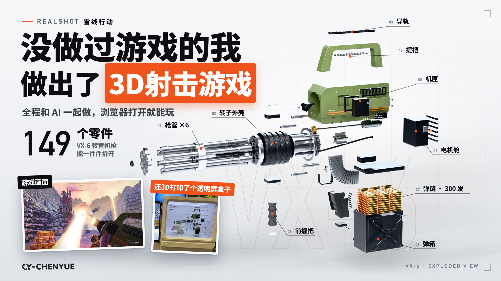
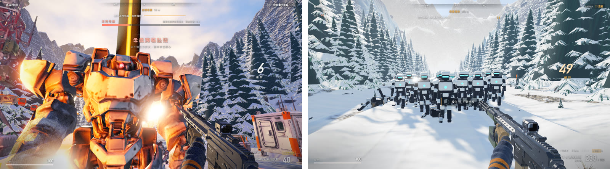
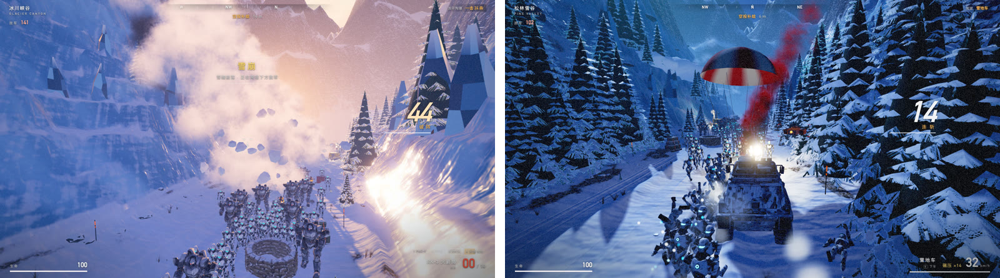
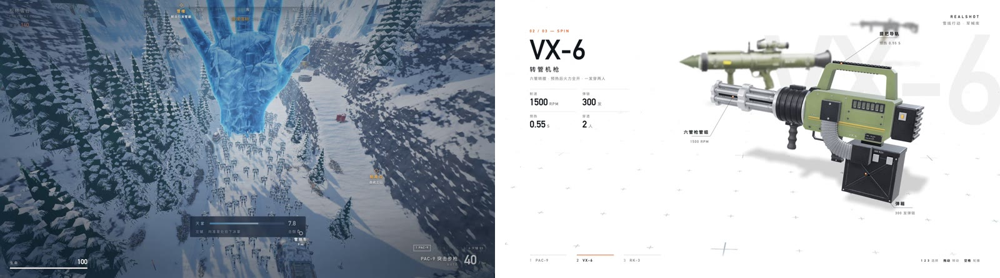
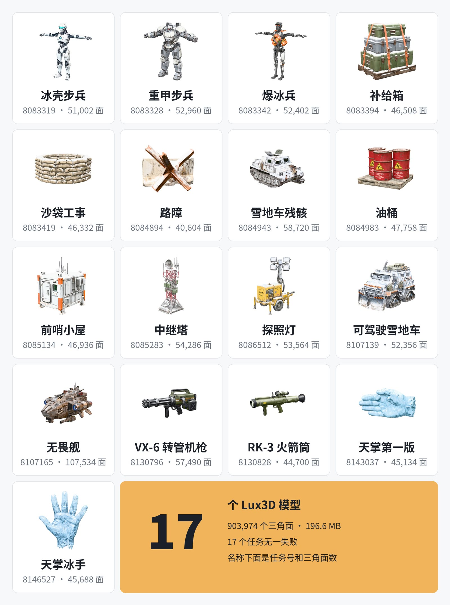
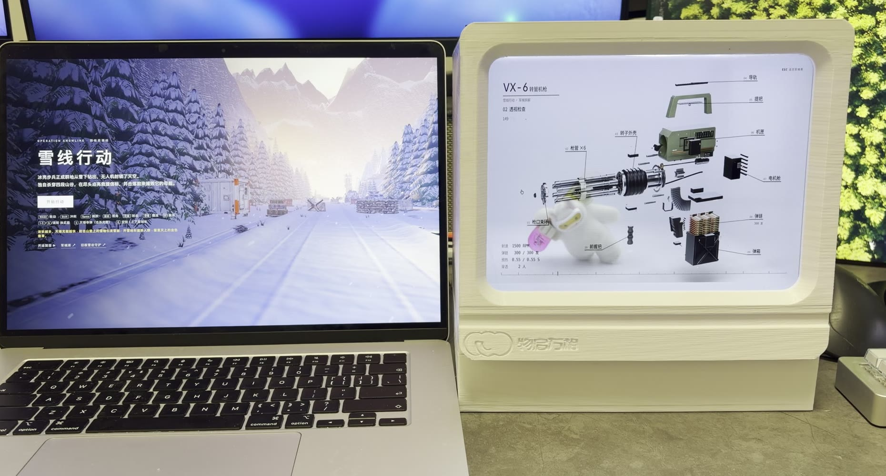
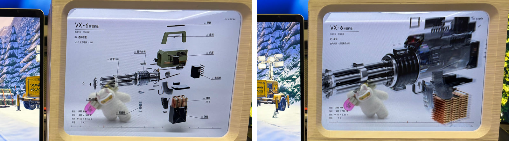
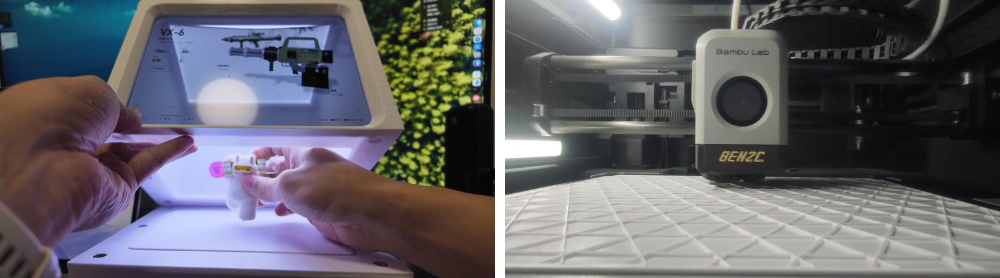

# RealShot · 雪线行动



《雪线行动》是一个在浏览器里运行的第一人称射击游戏：独自穿过四段雪山山谷，点亮尽头的救援信标，再击落赶来摧毁它的母舰。游戏里的敌人、载具、场景道具和两把重武器来自 17 个群核 Lux3D 生成的模型，每个模型都是 Agent 运行一条 [aholo-cli](https://github.com/CY-CHENYUE/aholo-cli) 命令得到的。同一个画面还能放进一台 3D 打印的透明屏盒子，盒子里的实物站在画面后面。

**[在线试玩](https://aiotwan.com/realshot/)** · **[项目报告书（飞书，含完整视频和全部素材）](https://ultraway.feishu.cn/wiki/MDrzwfGHriHIpSkJFx7cWoMnnlc)** · **[aholo-cli 源码](https://github.com/CY-CHENYUE/aholo-cli)**

## 三件成果

- **游戏**：《雪线行动》，四段山谷、三种冰壳步兵和无人机、三把武器、可驾驶的雪地车、空中支援和一场 Boss 战，用 three.js 编写。可以[在线试玩](https://aiotwan.com/realshot/)，源码就是本仓库，也可以[在自己电脑上运行](#三步运行)。
- **命令行工具**：aholo-cli，23 条命令封装群核 Lux3D 的文生 3D、图生 3D、材质迁移、绑骨、导出和下载，输出 JSON，Agent 可以直接调用；MIT 开源。源码在 [github.com/CY-CHENYUE/aholo-cli](https://github.com/CY-CHENYUE/aholo-cli)。
- **透明屏盒子**：3D 打印的外壳（230 × 220 × 250 mm）装一块 1920 × 1080 的透明屏，屏幕上白色的地方透光，能看见盒子里的实物。[实拍在下面](#透明屏盒子)。

## 游戏画面

以下都是游戏运行时的截图。



左：Boss 无畏舰第三阶段。右：群战，击杀越多，连击越高，天锤充能越快。



左：射击山壁上的雪檐，引发雪崩。右：夜里开雪地车撞穿人群。



左：空中支援“天掌”，冰手拍向敌群。右：军械库页，三把武器可以转动查看、拆解。

## 在线试玩

用电脑上的 Chrome 或 Edge 打开 **<https://aiotwan.com/realshot/>**，等载入完成后点“开始行动”，不用安装任何东西。军械库页在 <https://aiotwan.com/realshot/armory.html>。

第一次打开要下载约 95 MB 的模型、动作和声音，载入画面会显示已下载多少。也可以用下面的方法把源码下载到自己电脑上运行。操作按键见下一节的表格。

## 三步运行

需要 Node.js 22 或更新版本，和一个支持 WebGL 2 的桌面浏览器（开发和验证用的是 macOS 上的 Chrome）。

```bash
git clone https://github.com/CY-CHENYUE/realshot.git
cd realshot
npm install
npm start
```

终端会打印一行地址，例如 `RealShot http://127.0.0.1:62940/level.html`（62940 被占用时会换一个端口）。在浏览器里打开它，看到“雪线行动”标题页，点“开始行动”。开场影片可以按空格跳过。

| 按键 | 作用 |
|---|---|
| `W` `A` `S` `D` | 移动 |
| `Shift` / `Space` | 冲刺 / 跳跃 |
| 鼠标 / 左键 / 右键 | 视角 / 射击 / 瞄准 |
| `R` | 装填 |
| `1` `2` `3`、`Q`、滚轮 | 换武器（PAC-9 步枪、VX-6 转管机枪、RK-3 火箭筒） |
| `4` | 天锤导弹（靠击杀充能） |
| `E` | 打开空投箱，上下雪地车 |
| `P` / `M` | 暂停 / 静音 |

VX-6 和 RK-3 由途中降落的空投补给箱提供，走到箱子旁按住 `E` 打开。

## 模型是一条命令生成的

写一段文字描述，Agent 运行一条 aholo-cli 命令，群核 Lux3D 返回带贴图的模型。冰壳步兵用的是这一条：

```bash
aholo lux3d text-to-3d --prompt-file prompts/trooper.txt --style photorealistic \
  --model-version G1 --face-count 50000 --predict-size false \
  --request-id realshot-r26-trooper-text-v1 --download --max-wait 1800 \
  --out-dir output/trooper-text --timeout 120 --json --quiet
```

这次任务的编号是 8083319，从提交到下载完成 368 秒，得到 51,002 个三角面的模型。之后由脚本减面、烘焙成三级细节，远处的敌人换成低模，上百个同屏时也能流畅运行。其余 16 个模型走的是同一条路：



aholo-cli 的安装和全部命令见[它自己的仓库](https://github.com/CY-CHENYUE/aholo-cli)。运行游戏不需要它，也不需要任何 API 密钥：生成好的模型已经在 `assets/` 里。每个模型对应的任务号列在 [THIRD_PARTY_NOTICES.md](THIRD_PARTY_NOTICES.md)。

## 透明屏盒子

盒子的透明屏就是一块 1920 × 1080 的显示器，接上电脑后把浏览器窗口放过去即可，不需要单独的页面。军械库页（`/armory.html`）是白色背景：白色在透明屏上透光，所以盒子里的玩偶站在武器的后面。



电脑上是游戏，盒子里是军械库。白色玩偶是放在盒子里的实物，不是画面的一部分。



左：VX-6 拆成 149 个零件，悬在玩偶前面。右：外壳变透明，看里面的结构。



左：把玩偶放进盒子。右：外壳的 3D 打印过程。

外壳开口 195 × 146 mm。外壳的打印文件不在这个仓库里。

## 仓库里有什么

| 路径 | 内容 |
|---|---|
| `level.html` | 《雪线行动》，现在的游戏 |
| `armory.html` | 军械库：三把武器的展示和 VX-6 拆解 |
| `src/` | 53 个模块，约 1.1 万行，没有构建步骤，浏览器直接加载 |
| `assets/` | 模型、贴图、声音、开场和结局影片、指挥员语音 |
| `tests/` | `npm test` 运行的规则和数据测试，共 146 个 |
| `dev-crowd.html`、`dev-props.html` | 开发时查看敌人和道具模型的页面 |
| `.github/workflows/test.yml` | 每次推送后运行语法检查和测试 |

## 需要知道的边界

- **下载到本机运行时，PAC-9 步枪和左手用的是仓库里的这一套模型**（`assets/weapons/vm-carbine*`、`vm-arm*`），是本项目自己制作的。上面截图里的步枪、双手和换弹动作是另一套素材，文件不随仓库分发；两者的数值、瞄准和玩法相同，本机版只有左手，换弹是左手离开护木、整把枪下沉再抬起。
- **开场、结局影片和指挥员语音是 AI 生成的**，来源写在 `assets/cine/NOTICE.md` 和 `assets/voice/NOTICE.md`。
- **测试只覆盖规则和数据。** `npm test` 的 146 个测试全部通过，检查的是武器数值、敌人波次、关卡数据这类逻辑；画面和手感没有自动测试。
- **还没有选定开源许可。** 仓库里没有 LICENSE 文件；第三方素材和生成素材各自的来源与许可见 [THIRD_PARTY_NOTICES.md](THIRD_PARTY_NOTICES.md)。
- 只支持键盘和鼠标，没有适配手机和手柄。

## 链接

- [在线试玩](https://aiotwan.com/realshot/)：浏览器里直接玩，需要电脑、键盘和鼠标
- [项目报告书（飞书）](https://ultraway.feishu.cn/wiki/MDrzwfGHriHIpSkJFx7cWoMnnlc)：完整视频、创意、制作过程、迭代对比和全部素材
- [aholo-cli](https://github.com/CY-CHENYUE/aholo-cli)：调用群核 Lux3D 的命令行工具
- [素材来源与许可](THIRD_PARTY_NOTICES.md)

作者：CY-CHENYUE

## 关注公众号

<div align="center">
  <p>扫码关注公众号，获取更新与交流反馈</p>
  
</div>
